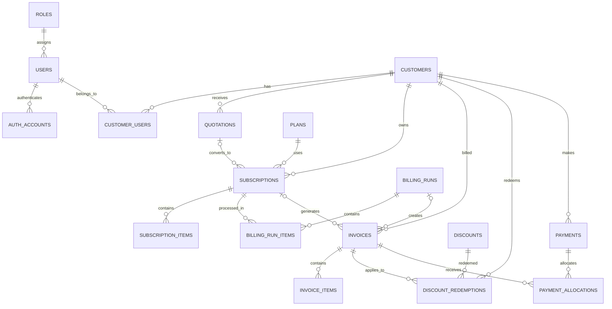

# Brightloop Subscription Management System
## Database Documentation

**Database:** PostgreSQL (Neon)  
**Currency convention:** All monetary amounts are stored as integer paise (₹1 = 100 paise), unless explicitly stated otherwise.  
**Status:** Database structure verified — 18 tables present.

---

## 1. Overview

This document describes the database design for the Brightloop Subscription Management System. It records the purpose, columns, relationships, constraints, indexes, and important implementation rules for each table.

The system supports:
- User authentication and role-based access.
- Customer organizations and customer-user membership.
- Product and subscription plan configuration.
- Quotations and subscription lifecycle management.
- Recurring billing runs and invoice generation.
- Discounts and redemption tracking.
- Payments and invoice allocation.

### 1.1 Design principles

1. **Store money as integers.** Monetary values use paise to avoid floating-point precision errors.
2. **Snapshot commercial terms.** Quotations, subscriptions, and invoices preserve the product names, quantities, and prices agreed at the time of the transaction.
3. **Keep issued invoices immutable.** Corrections should use void/reissue or an appropriate credit-note workflow rather than editing issued financial records.
4. **Make recurring billing idempotent.** A subscription billing period must not produce more than one valid invoice.
5. **Enforce financial rules transactionally.** Discount quotas, payment allocations, and invoice creation require database transactions and appropriate row locks.
6. **Separate global roles from customer membership roles.** A user's system role is distinct from their role within a customer organization.

---

## 2. Entity Relationship Overview



> The diagram is a conceptual overview. The actual foreign-key constraints and delete actions are defined in the table sections below and in the database schema.

---

## 3. Authentication and User Management

### 3.1 `roles`

**Purpose:** Stores global application roles used for role-based access control (RBAC).

| Column | Type | Null | Default | Description |
|---|---|---:|---|---|
| `id` | UUID | No | `gen_random_uuid()` | Primary key. |
| `name` | VARCHAR(30) | No | — | Unique role name, such as `admin`, `staff`, or `customer`. |
| `description` | TEXT | Yes | — | Human-readable role description. |
| `created_at` | TIMESTAMPTZ | Yes | `now()` | Record creation time. |

**Constraints and indexes**
- Primary key on `id`.
- Unique constraint on `name`.

**Seed roles:** `admin`, `staff`, `customer`.

**Important:** Public registration must not allow the caller to choose an elevated role. New public registrations should be assigned the `customer` role by the backend. Admin and staff accounts must be provisioned through an authorized process.

### 3.2 `users`

**Purpose:** Stores application login identities and profile information.

| Column | Type | Null | Default | Description |
|---|---|---:|---|---|
| `id` | UUID | No | `gen_random_uuid()` | Primary key. |
| `full_name` | VARCHAR(150) | No | — | User's display name. |
| `email` | VARCHAR(255) | No | — | Login email address. |
| `role_id` | UUID | No | — | References `roles.id`. |
| `status` | VARCHAR(20) | Yes | `active` | Account status: `active`, `inactive`, or `suspended`. |
| `email_verified` | BOOLEAN | Yes | `false` | Whether the email address has been verified. |
| `created_at` | TIMESTAMPTZ | Yes | `now()` | Creation timestamp. |
| `updated_at` | TIMESTAMPTZ | Yes | `now()` | Last update timestamp. |

**Constraints and indexes**
- Primary key on `id`.
- Foreign key `role_id` → `roles.id`.
- Email uniqueness is enforced case-insensitively with a unique index on `LOWER(email)`.
- Indexes on `role_id` and `status`.

**Implementation notes**
- Normalize email addresses consistently before lookup and storage.
- Enforce password policy in the authentication layer.
- Do not trust a role value supplied by a public registration request.

### 3.3 `auth_accounts`

**Purpose:** Separates login-provider credentials from the user profile and supports local and Google authentication.

| Column | Type | Null | Default | Description |
|---|---|---:|---|---|
| `id` | UUID | No | `gen_random_uuid()` | Primary key. |
| `user_id` | UUID | No | — | References `users.id`. |
| `provider` | VARCHAR(20) | No | — | Authentication provider: `local` or `google`. |
| `provider_account_id` | TEXT | Yes | — | Provider's stable account identifier; for Google, use the `sub` claim. |
| `password_hash` | TEXT | Yes | — | Secure password hash for local authentication. |
| `reset_token_hash` | TEXT | Yes | — | Hashed password-reset token. |
| `reset_token_expires_at` | TIMESTAMPTZ | Yes | — | Reset-token expiry timestamp. |
| `created_at` | TIMESTAMPTZ | Yes | `now()` | Creation timestamp. |

**Constraints and indexes**
- Primary key on `id`.
- Foreign key `user_id` → `users.id` with `ON DELETE CASCADE`.
- Unique constraint on `(user_id, provider)`.
- Local provider requires a password hash and no provider account ID.
- Google provider requires a provider account ID and no password hash; reset-token fields must be null.
- Reset-token hash and expiry must either both be null or both be present.
- Partial unique index on `(provider, provider_account_id)` for Google accounts.

**Security notes**
- Never store plaintext passwords or plaintext reset tokens.
- Use Google's stable `sub` identifier, not the email address, as the provider account ID.
- Do not automatically link accounts only because their email addresses match. Verify control of the existing account first.

---

## 4. Customer Management

### 4.1 `customers`

**Purpose:** Represents the organization or individual purchasing subscriptions from Brightloop.

| Column | Type | Null | Default | Description |
|---|---|---:|---|---|
| `id` | UUID | No | `gen_random_uuid()` | Primary key. |
| `customer_name` | VARCHAR(200) | No | — | Customer or organization name. |
| `customer_type` | VARCHAR(20) | No | — | `individual` or `business`. |
| `legal_name` | VARCHAR(200) | Yes | — | Registered legal name, where applicable. |
| `email` | VARCHAR(255) | Yes | — | Customer contact email. |
| `phone` | VARCHAR(20) | Yes | — | Contact phone number. |
| `tax_id` | VARCHAR(50) | Yes | — | Tax registration identifier, if applicable. |
| `billing_address_line1` | VARCHAR(255) | Yes | — | Primary billing address line. |
| `billing_address_line2` | VARCHAR(255) | Yes | — | Additional billing address line. |
| `city` | VARCHAR(100) | Yes | — | Billing city. |
| `state` | VARCHAR(100) | Yes | — | Billing state or region. |
| `postal_code` | VARCHAR(20) | Yes | — | Postal or PIN code. |
| `country` | VARCHAR(100) | Yes | — | Billing country. |
| `status` | VARCHAR(20) | Yes | `active` | `active` or `inactive`. |
| `created_at` | TIMESTAMPTZ | Yes | `now()` | Creation timestamp. |
| `updated_at` | TIMESTAMPTZ | Yes | `now()` | Last update timestamp. |

**Constraints and indexes**
- Primary key on `id`.
- Check constraint restricts `customer_type` to `individual` or `business`.
- Check constraint restricts `status` to `active` or `inactive`.

**Business meaning:** Brightloop is the service provider. A customer such as ABC Technologies is the purchasing organization. Users such as John or Alex can log in on behalf of that organization.

### 4.2 `customer_users`

**Purpose:** Connects application users to customer accounts and defines their membership-level permissions.

| Column | Type | Null | Default | Description |
|---|---|---:|---|---|
| `id` | UUID | No | `gen_random_uuid()` | Primary key. |
| `customer_id` | UUID | No | — | References `customers.id`. |
| `user_id` | UUID | No | — | References `users.id`. |
| `membership_role` | VARCHAR(20) | No | — | `owner`, `manager`, or `member`. |
| `is_primary` | BOOLEAN | Yes | `false` | Marks the primary contact for the customer. |
| `joined_at` | TIMESTAMPTZ | Yes | `now()` | Membership creation time. |

**Constraints and indexes**
- Primary key on `id`.
- Foreign keys to `customers.id` and `users.id`.
- Unique constraint on `(customer_id, user_id)`.
- Check constraint for membership role.
- Indexes on `customer_id` and `user_id`.
- Partial unique index allows at most one primary user per customer.

**Important distinction:** `admin`, `staff`, and `customer` are global application roles. `owner`, `manager`, and `member` are roles within a particular customer account.

---

## 5. Product and Plan Management

### 5.1 `products`

**Purpose:** Stores the products or services that Brightloop offers.

| Column | Type | Null | Default | Description |
|---|---|---:|---|---|
| `id` | UUID | No | `gen_random_uuid()` | Primary key. |
| `name` | VARCHAR(150) | No | — | Product or service name. |
| `description` | TEXT | Yes | — | Product description. |
| `product_type` | VARCHAR(30) | No | — | Product classification. |
| `sales_price` | BIGINT | No | — | Catalogue sales price in paise. |
| `cost_price` | BIGINT | Yes | `0` | Internal cost in paise. |
| `variants` | JSONB | Yes | `[]` | Product variants and their price adjustments. |
| `notes` | TEXT | Yes | — | Internal notes. |
| `status` | VARCHAR(20) | Yes | `active` | `active` or `inactive`. |
| `created_at` | TIMESTAMPTZ | Yes | `now()` | Creation timestamp. |
| `updated_at` | TIMESTAMPTZ | Yes | `now()` | Last update timestamp. |

**Constraints and indexes**
- Primary key on `id`.
- Non-negative checks for monetary fields.
- Check constraint ensures `variants` is a JSON array.
- Indexes on `status` and `name`.

**Variant example**

```json
[
  {
    "name": "Standard",
    "price_adjustment": 0
  },
  {
    "name": "Premium",
    "price_adjustment": 56000
  }
]
```

`price_adjustment` is in paise. The example premium adjustment is ₹560.

**Design trade-off:** Variants are stored in JSONB to keep the schema compact. PostgreSQL does not enforce a foreign-key relationship inside arbitrary JSON values. The backend must validate variant names and values. Transactional records must snapshot the selected variant and agreed price.

### 5.2 `plans`

**Purpose:** Defines recurring subscription plans and their billing configuration.

| Column | Type | Null | Default | Description |
|---|---|---:|---|---|
| `id` | UUID | No | `gen_random_uuid()` | Primary key. |
| `name` | VARCHAR(150) | No | — | Plan name. |
| `description` | TEXT | Yes | — | Plan description. |
| `billing_interval` | VARCHAR(20) | No | — | `daily`, `weekly`, `monthly`, or `yearly`. |
| `price` | BIGINT | No | — | Plan price in paise. |
| `currency` | CHAR(3) | Yes | `INR` | Currency code. |
| `minimum_quantity` | INTEGER | Yes | `1` | Minimum allowed subscription quantity. |
| `included_products` | JSONB | Yes | `[]` | Product, variant, and quantity configuration included in the plan. |
| `available_from` | DATE | Yes | — | First date the plan can be selected. |
| `available_until` | DATE | Yes | — | Last date the plan can be selected. |
| `auto_close` | BOOLEAN | Yes | `false` | Whether the plan can automatically close under configured lifecycle rules. |
| `allow_early_close` | BOOLEAN | Yes | `true` | Whether early closure is allowed. |
| `allow_pause` | BOOLEAN | Yes | `true` | Whether pausing is allowed. |
| `allow_renewal` | BOOLEAN | Yes | `true` | Whether renewal is allowed. |
| `status` | VARCHAR(20) | Yes | `active` | `active` or `inactive`. |
| `created_at` | TIMESTAMPTZ | Yes | `now()` | Creation timestamp. |
| `updated_at` | TIMESTAMPTZ | Yes | `now()` | Last update timestamp. |

**Constraints and indexes**
- Primary key on `id`.
- Check constraints for supported billing intervals, positive minimum quantity, non-negative price, valid availability date range, and JSON array type.
- Indexes on `status` and `billing_interval`.

**Implementation notes**
- The subscription stores the billing interval and agreed plan price as snapshots. Editing a plan must not silently change existing subscriptions.
- Validate every product reference inside `included_products` in backend logic.

---

## 6. Quotation Management

### 6.1 `quotations`

**Purpose:** Stores customer-specific quotations created from reusable quotation templates.

Quotation templates are static JSON files in the backend repository, for example:

```text
src/templates/quotations/standard.json
```

They are not stored as database rows. The `template_name` column records which template was used.

| Column | Type | Null | Default | Description |
|---|---|---:|---|---|
| `id` | UUID | No | `gen_random_uuid()` | Primary key. |
| `quotation_number` | VARCHAR(50) | No | — | Unique human-readable quotation number. |
| `customer_id` | UUID | No | — | References `customers.id`. |
| `created_by` | UUID | Yes | — | References `users.id`. |
| `template_name` | VARCHAR(100) | Yes | — | Name of the repository template used. |
| `title` | VARCHAR(200) | No | — | Quotation title. |
| `items` | JSONB | Yes | `[]` | Quoted line-item snapshots. |
| `subtotal` | BIGINT | Yes | `0` | Amount before discount and tax, in paise. |
| `discount_amount` | BIGINT | Yes | `0` | Discount amount in paise. |
| `tax_amount` | BIGINT | Yes | `0` | Tax amount in paise. |
| `total_amount` | BIGINT | Yes | `0` | Final quotation amount in paise. |
| `valid_until` | DATE | Yes | — | Quotation expiry date. |
| `status` | VARCHAR(20) | Yes | `draft` | `draft`, `sent`, `accepted`, `rejected`, `expired`, or `converted`. |
| `notes` | TEXT | Yes | — | Additional terms or notes. |
| `created_at` | TIMESTAMPTZ | Yes | `now()` | Creation timestamp. |
| `updated_at` | TIMESTAMPTZ | Yes | `now()` | Last update timestamp. |

**Constraints and indexes**
- Primary key on `id`.
- Unique constraint on `quotation_number`.
- Foreign keys to `customers.id` and `users.id`.
- Check constraint ensures `items` is a JSON array.
- Indexes on `customer_id`, `status`, and `created_by`.

**Example item snapshot**

```json
{
  "product_id": "product-uuid",
  "product_name": "Odoo Implementation",
  "variant": "Premium",
  "quantity": 1,
  "unit_price": 250000,
  "line_total": 250000
}
```

Amounts are in paise. The backend must calculate totals; values submitted by the frontend must not be trusted.

---

## 7. Subscription Management

### 7.1 `subscriptions`

**Purpose:** Represents a customer's agreement to receive a product or service on a recurring basis.

| Column | Type | Null | Default | Description |
|---|---|---:|---|---|
| `id` | UUID | No | `gen_random_uuid()` | Primary key. |
| `subscription_number` | VARCHAR(50) | No | — | Unique human-readable subscription number. |
| `customer_id` | UUID | No | — | References `customers.id`. |
| `quotation_id` | UUID | Yes | — | Source quotation, if converted from one. |
| `plan_id` | UUID | No | — | References `plans.id`. |
| `created_by` | UUID | Yes | — | References `users.id`. |
| `start_date` | DATE | No | — | Subscription start date. |
| `end_date` | DATE | Yes | — | Optional subscription end date. |
| `next_billing_date` | DATE | Yes | — | Next scheduled billing date. |
| `billing_interval` | VARCHAR(20) | No | — | Billing interval snapshot. |
| `plan_price` | BIGINT | No | `0` | Agreed plan price snapshot in paise. |
| `status` | VARCHAR(20) | Yes | `draft` | `draft`, `quotation`, `confirmed`, `active`, `paused`, or `closed`. |
| `auto_renew` | BOOLEAN | Yes | `true` | Whether renewal is enabled. |
| `paused_at` | TIMESTAMPTZ | Yes | — | Time the subscription was paused. |
| `closed_at` | TIMESTAMPTZ | Yes | — | Time the subscription was closed. |
| `created_at` | TIMESTAMPTZ | Yes | `now()` | Creation timestamp. |
| `updated_at` | TIMESTAMPTZ | Yes | `now()` | Last update timestamp. |

**Constraints and indexes**
- Primary key on `id`.
- Foreign keys to customers, quotations, plans, and users.
- Unique constraint on `subscription_number`.
- Checks for supported billing intervals, valid date ordering, and non-negative `plan_price`.
- Indexes on `customer_id`, `plan_id`, `status`, and `next_billing_date`.

### 7.2 `subscription_items`

**Purpose:** Stores the products and quantities included in a subscription, with agreed-price snapshots.

| Column | Type | Null | Default | Description |
|---|---|---:|---|---|
| `id` | UUID | No | `gen_random_uuid()` | Primary key. |
| `subscription_id` | UUID | No | — | References `subscriptions.id`. |
| `product_id` | UUID | No | — | References `products.id`. |
| `product_name` | VARCHAR(150) | No | — | Product-name snapshot. |
| `variant_name` | VARCHAR(150) | Yes | — | Selected variant snapshot. |
| `quantity` | INTEGER | No | `1` | Number of units; must be positive. |
| `unit_price` | BIGINT | No | — | Agreed unit price in paise. |
| `created_at` | TIMESTAMPTZ | Yes | `now()` | Creation timestamp. |

**Constraints and indexes**
- Primary key on `id`.
- Foreign keys to `subscriptions.id` (`ON DELETE CASCADE`) and `products.id`.
- Positive quantity and non-negative unit-price checks.
- Index on `subscription_id`.

**Conversion workflow:** Convert a quotation into a subscription and its subscription items in one database transaction. Update the quotation status to `converted` in that same transaction. Populate `plan_price` with the agreed price; do not rely on its database default of zero.

---

## 8. Billing Run Management

### 8.1 `billing_runs`

**Purpose:** Records each scheduled or manually initiated billing batch.

| Column | Type | Null | Default | Description |
|---|---|---:|---|---|
| `id` | UUID | No | `gen_random_uuid()` | Primary key. |
| `run_number` | VARCHAR(50) | No | — | Unique billing-run reference. |
| `billing_date` | DATE | No | — | Date for which billing is executed. |
| `status` | VARCHAR(20) | Yes | `pending` | `pending`, `processing`, `completed`, `partially_failed`, `failed`, or `cancelled`. |
| `created_by` | UUID | Yes | — | References `users.id`, if manually initiated. |
| `started_at` | TIMESTAMPTZ | Yes | — | Processing start time. |
| `completed_at` | TIMESTAMPTZ | Yes | — | Processing completion time. |
| `total_subscriptions` | INTEGER | Yes | `0` | Number of subscriptions considered. |
| `invoices_created` | INTEGER | Yes | `0` | Number of invoices successfully created. |
| `failure_count` | INTEGER | Yes | `0` | Number of failed items. |
| `created_at` | TIMESTAMPTZ | Yes | `now()` | Creation timestamp. |

**Constraints and indexes**
- Primary key on `id`.
- Unique constraint on `run_number`.
- Foreign key `created_by` → `users.id`.
- Non-negative counter checks.
- Completion timestamp must not precede start timestamp.
- Indexes on `billing_date` and `status`.

### 8.2 `billing_run_items`

**Purpose:** Records the result of processing each subscription during a billing run.

| Column | Type | Null | Default | Description |
|---|---|---:|---|---|
| `id` | UUID | No | `gen_random_uuid()` | Primary key. |
| `billing_run_id` | UUID | No | — | References `billing_runs.id`. |
| `subscription_id` | UUID | No | — | References `subscriptions.id`. |
| `period_index` | INTEGER | No | — | Sequential billing-period number for the subscription. |
| `period_start` | DATE | No | — | Start of the billing period. |
| `period_end` | DATE | No | — | End of the billing period. |
| `status` | VARCHAR(20) | Yes | `pending` | `pending`, `success`, `failed`, or `skipped`. |
| `invoice_id` | UUID | Yes | — | Invoice created for this item, if successful. |
| `failure_reason` | TEXT | Yes | — | Failure explanation, if applicable. |
| `processed_at` | TIMESTAMPTZ | Yes | — | Processing completion time. |
| `created_at` | TIMESTAMPTZ | Yes | `now()` | Creation timestamp. |

**Constraints and indexes**
- Primary key on `id`.
- Foreign keys to billing runs, subscriptions, and invoices.
- Unique constraint on `(billing_run_id, subscription_id)`.
- Positive `period_index`.
- `period_end` must not precede `period_start`.
- Indexes on `subscription_id` and `(billing_run_id, status)`.

**Idempotency note:** The unique constraint above prevents duplicate processing entries inside one run. Cross-run duplicate invoice prevention is handled by the unique recurring-period index on `invoices(subscription_id, period_index)`.

---

## 9. Invoice Management

### 9.1 `invoices`

**Purpose:** Stores customer invoices, including recurring invoices generated by billing runs.

| Column | Type | Null | Default | Description |
|---|---|---:|---|---|
| `id` | UUID | No | `gen_random_uuid()` | Primary key. |
| `invoice_number` | VARCHAR(50) | No | — | Unique human-readable invoice number. |
| `customer_id` | UUID | No | — | References `customers.id`. |
| `subscription_id` | UUID | Yes | — | Source subscription for recurring invoices. |
| `billing_run_id` | UUID | Yes | — | Billing run that generated the invoice. |
| `period_index` | INTEGER | Yes | — | Subscription billing-period number. |
| `billing_period_start` | DATE | Yes | — | Start of invoiced period. |
| `billing_period_end` | DATE | Yes | — | End of invoiced period. |
| `issue_date` | DATE | Yes | `CURRENT_DATE` | Invoice issue date. |
| `due_date` | DATE | No | — | Payment due date. |
| `status` | VARCHAR(20) | Yes | `draft` | `draft`, `issued`, `partially_paid`, `paid`, or `void`. |
| `subtotal` | BIGINT | Yes | `0` | Amount before discount and tax, in paise. |
| `discount_amount` | BIGINT | Yes | `0` | Discount in paise. |
| `tax_amount` | BIGINT | Yes | `0` | Tax in paise. |
| `total_amount` | BIGINT | Yes | `0` | Final invoice total in paise. |
| `notes` | TEXT | Yes | — | Invoice notes or terms. |
| `created_by` | UUID | Yes | — | References `users.id`. |
| `issued_at` | TIMESTAMPTZ | Yes | — | Time the invoice was issued. |
| `created_at` | TIMESTAMPTZ | Yes | `now()` | Creation timestamp. |
| `updated_at` | TIMESTAMPTZ | Yes | `now()` | Last update timestamp. |

**Constraints and indexes**
- Primary key on `id`.
- Unique constraint on `invoice_number`.
- Foreign keys to customers, subscriptions, billing runs, and users.
- Recurring invoice check requires `subscription_id` and `period_index` to be either both null or both non-null.
- Billing period start must not exceed billing period end.
- Discount cannot exceed subtotal.
- Partial unique index on `(subscription_id, period_index)` where both values are non-null and status is not `void`.
- Indexes on `customer_id`, `(status, due_date)`, and `subscription_id`.

**Financial rules**
- Backend validates `total_amount = subtotal - discount_amount + tax_amount`.
- Once issued, an invoice must not be edited in place.
- Corrections should use void/reissue or a credit-note workflow.
- Outstanding amount is derived from confirmed payment allocations.
- An invoice is overdue when it has an outstanding balance and its due date has passed.

### 9.2 `invoice_items`

**Purpose:** Stores invoice line items as immutable descriptions and price snapshots.

| Column | Type | Null | Default | Description |
|---|---|---:|---|---|
| `id` | UUID | No | `gen_random_uuid()` | Primary key. |
| `invoice_id` | UUID | No | — | References `invoices.id`. |
| `product_id` | UUID | Yes | — | References `products.id`, if applicable. |
| `description` | VARCHAR(255) | No | — | Product or service description snapshot. |
| `quantity` | INTEGER | No | — | Billed quantity; must be positive. |
| `unit_price` | BIGINT | No | — | Unit price in paise. |
| `discount_amount` | BIGINT | Yes | `0` | Line discount in paise. |
| `tax_rate` | INTEGER | Yes | `0` | Tax rate in basis points (e.g. 1800 = 18%). |
| `tax_amount` | BIGINT | Yes | `0` | Tax amount in paise. |
| `line_total` | BIGINT | Yes | `0` | Final line total in paise. |

**Constraints and indexes**
- Primary key on `id`.
- Foreign keys to `invoices.id` (`ON DELETE CASCADE`) and `products.id`.
- Positive quantity.
- Non-negative price, discount, tax, and line-total checks.
- Discount cannot exceed `quantity * unit_price`.
- Tax rate must be between 0 and 10000 basis points.
- Index on `invoice_id`.

**Important:** Preserve product description and agreed price on the invoice. Do not recalculate old invoices from the current product catalogue.

---

## 10. Discount Management

### 10.1 `discounts`

**Purpose:** Defines fixed-value or percentage discounts and their eligibility limits.

| Column | Type | Null | Default | Description |
|---|---|---:|---|---|
| `id` | UUID | No | `gen_random_uuid()` | Primary key. |
| `name` | VARCHAR(150) | No | — | Discount display name. |
| `code` | VARCHAR(50) | No | — | Unique discount code. |
| `discount_type` | VARCHAR(20) | No | — | `fixed` or `percentage`. |
| `discount_value` | BIGINT | No | — | Fixed paise amount or percentage basis points. |
| `minimum_purchase` | BIGINT | Yes | `0` | Minimum purchase amount in paise. |
| `minimum_quantity` | INTEGER | Yes | `1` | Minimum eligible quantity. |
| `starts_at` | TIMESTAMPTZ | Yes | — | Discount activation time. |
| `ends_at` | TIMESTAMPTZ | Yes | — | Discount expiry time. |
| `max_redemptions` | INTEGER | Yes | — | Optional global redemption limit. |
| `status` | VARCHAR(20) | Yes | `active` | `active` or `inactive`. |
| `created_at` | TIMESTAMPTZ | Yes | `now()` | Creation timestamp. |
| `updated_at` | TIMESTAMPTZ | Yes | `now()` | Last update timestamp. |

**Constraints and indexes**
- Primary key on `id`.
- Unique constraint on `code`.
- Check for supported discount types.
- Discount value must be positive.
- Percentage value must not exceed 10000 basis points (100%).
- Minimum purchase must be non-negative; minimum quantity positive.
- Maximum redemptions, if present, must be positive.
- End time must be later than start time.
- Indexes on `status` and validity timestamps.

### 10.2 `discount_redemptions`

**Purpose:** Records each discount applied to an invoice.

| Column | Type | Null | Default | Description |
|---|---|---:|---|---|
| `id` | UUID | No | `gen_random_uuid()` | Primary key. |
| `discount_id` | UUID | No | — | References `discounts.id`. |
| `invoice_id` | UUID | No | — | References `invoices.id`. |
| `customer_id` | UUID | No | — | References `customers.id`. |
| `discount_amount` | BIGINT | No | — | Actual discount applied, in paise. |
| `redeemed_at` | TIMESTAMPTZ | Yes | `now()` | Redemption timestamp. |

**Constraints and indexes**
- Primary key on `id`.
- Foreign keys to discounts, invoices, and customers.
- Unique constraint on `(discount_id, invoice_id)`.
- Positive discount amount.
- Indexes on `customer_id` and `discount_id`.

**Implementation notes**
- Validate active status, time window, minimum purchase, and minimum quantity.
- Enforce redemption quotas transactionally to avoid concurrent requests exceeding the limit.
- Verify that the redemption customer matches the invoice customer.

---

## 11. Payment Management

### 11.1 `payments`

**Purpose:** Records money received from a customer. A payment can be allocated to one or more invoices.

| Column | Type | Null | Default | Description |
|---|---|---:|---|---|
| `id` | UUID | No | `gen_random_uuid()` | Primary key. |
| `payment_reference` | VARCHAR(50) | No | — | Unique internal payment reference. |
| `customer_id` | UUID | No | — | References `customers.id`. |
| `amount` | BIGINT | No | — | Received amount in paise. |
| `payment_method` | VARCHAR(20) | No | — | `UPI`, `bank_transfer`, `cash`, `card`, `cheque`, or `other`. |
| `payment_date` | TIMESTAMPTZ | Yes | `now()` | Time payment was received. |
| `status` | VARCHAR(20) | Yes | `confirmed` | `confirmed` or `reversed`. |
| `transaction_reference` | VARCHAR(150) | Yes | — | External transaction or bank reference. |
| `notes` | TEXT | Yes | — | Additional payment notes. |
| `recorded_by` | UUID | Yes | — | References `users.id`. |
| `created_at` | TIMESTAMPTZ | Yes | `now()` | Record creation timestamp. |

**Constraints and indexes**
- Primary key on `id`.
- Unique constraint on `payment_reference`.
- Foreign keys to customers and users.
- Positive amount check.
- Check constraints for payment method and status.
- Indexes on `customer_id`, `payment_date`, and `status`.

### 11.2 `payment_allocations`

**Purpose:** Allocates a payment amount to a specific invoice.

| Column | Type | Null | Default | Description |
|---|---|---:|---|---|
| `id` | UUID | No | `gen_random_uuid()` | Primary key. |
| `payment_id` | UUID | No | — | References `payments.id`. |
| `invoice_id` | UUID | No | — | References `invoices.id`. |
| `allocated_amount` | BIGINT | No | — | Amount allocated in paise. |
| `allocated_at` | TIMESTAMPTZ | Yes | `now()` | Allocation timestamp. |

**Constraints and indexes**
- Primary key on `id`.
- Foreign keys to payments and invoices.
- Unique constraint on `(payment_id, invoice_id)`.
- Positive allocation amount.
- Indexes on `payment_id` and `invoice_id`.

**Transactional validation**
- Payment and invoice must belong to the same customer.
- Sum of allocations must not exceed the payment amount.
- Allocations must not exceed the invoice's outstanding balance.
- Payment must be confirmed.
- Use a transaction and row-level locking when checking and updating allocations.
- Reversals must correctly remove or reverse their effect on invoice balances.

---

## 12. Relationship and Ownership Summary

| Parent | Child | Relationship purpose |
|---|---|---|
| `roles` | `users` | Assigns global application roles. |
| `users` | `auth_accounts` | Associates login providers with a user. |
| `customers` | `customer_users` | Associates users with customer accounts. |
| `users` | `customer_users` | Allows a user to belong to customer accounts. |
| `customers` | `quotations` | Identifies the quotation recipient. |
| `customers` | `subscriptions` | Identifies the subscription owner. |
| `plans` | `subscriptions` | Identifies the selected plan. |
| `quotations` | `subscriptions` | Records quotation conversion source. |
| `subscriptions` | `subscription_items` | Lists subscription products. |
| `billing_runs` | `billing_run_items` | Records work performed in a billing run. |
| `subscriptions` | `billing_run_items` | Identifies subscriptions processed. |
| `customers` | `invoices` | Identifies the billed customer. |
| `subscriptions` | `invoices` | Links recurring invoices to subscriptions. |
| `invoices` | `invoice_items` | Lists invoice line items. |
| `discounts` | `discount_redemptions` | Tracks discount usage. |
| `invoices` | `discount_redemptions` | Identifies invoices using discounts. |
| `customers` | `payments` | Identifies who paid. |
| `payments` | `payment_allocations` | Splits payments across invoices. |
| `invoices` | `payment_allocations` | Identifies which invoices received payments. |

---

## 13. Financial and Billing Rules

### 13.1 Monetary representation

- Store monetary values as `BIGINT` paise.
- ₹1.00 is stored as `100`.
- Do not use floating-point types for money.
- Convert paise to formatted rupees only at the API/UI boundary.
- Percentage tax and percentage discounts use basis points: 100 basis points = 1%; 1800 basis points = 18%.

### 13.2 Invoice calculation

At invoice level:

```text
total_amount = subtotal - discount_amount + tax_amount
```

At line level, calculate from integer minor units and the agreed rounding rule. The application must use one documented rounding policy consistently (the billing specification calls for half-up rounding). Validate all client-supplied amounts on the server.

### 13.3 Recurring billing idempotency

- A billing run records which subscriptions it attempted to process.
- Each billing-run item records its target period and result.
- The unique recurring invoice index on `(subscription_id, period_index)` prevents more than one non-void invoice for the same subscription period.
- Invoice creation and billing-run item success updates should be committed in the same transaction.
- Retry logic must distinguish failed work from already completed work.
- Do not assume a unique `(billing_run_id, subscription_id)` constraint alone prevents duplicates across separate runs.

### 13.4 Invoice lifecycle

- Draft invoices can be calculated and reviewed.
- Issued invoices should be immutable.
- Use void/reissue or a credit-note process to correct issued invoices.
- Do not delete financial history to correct an error.
- Outstanding and overdue values should be derived from confirmed payment allocations and due dates.

### 13.5 Discount lifecycle

- Validate eligibility immediately before redemption.
- Reserve or consume limited redemption capacity transactionally.
- Store the actual applied discount amount in `discount_redemptions`.
- Prevent a discount from being applied more than once to the same invoice.

### 13.6 Payment allocation

- A payment may be allocated across multiple invoices.
- An invoice may receive allocations from multiple payments.
- Keep payment receipt separate from payment allocation.
- Reconcile reversals so that balances remain correct.
- Do not mark an invoice paid merely because a payment record exists; use confirmed allocations.

---

## 14. Indexing and Performance Notes

The schema includes indexes for common lookup paths:
- User role and account status.
- Customer membership by user and customer.
- Product and plan status.
- Quotations by customer and status.
- Subscriptions by customer, plan, status, and next billing date.
- Billing runs by date and status.
- Billing-run items by run/status and subscription.
- Invoices by customer, status/due date, and subscription.
- Discounts by status and validity.
- Payments by customer, date, and status.
- Allocations by payment and invoice.

For the competition's response-time target, use pagination, selective columns, indexed filters, and aggregate queries. Avoid loading every invoice or subscription into application memory to calculate dashboard totals. Validate performance using realistic test data with thousands of subscriptions and invoices.

---

## 15. Security and Access-Control Rules

| Actor | Expected access |
|---|---|
| Admin | Manage users/staff, catalogue, plans, quotations, subscriptions, billing, invoices, discounts, payments, and reports. |
| Staff | Access only the operational functions granted by the application policy. |
| Customer | Access only their own customer account, subscriptions, quotations, invoices, and payment history. |

Implementation requirements:
- Enforce authorization in backend services/routes, not only by hiding frontend controls.
- Scope customer-facing queries through the authenticated user's `customer_users` memberships.
- Validate ownership on every customer resource request.
- Never accept `customer_id`, `role_id`, totals, or allocation balances from a client without authorization and server-side validation.
- Store password hashes and hashed reset tokens only.
- Record sensitive financial and administrative changes in an audit trail.

---

## 16. Known Design Trade-offs and Scope

The current 18-table schema is a deliberately compact competition implementation.

| Area | Current design | Trade-off / follow-up |
|---|---|---|
| Product variants | JSONB in `products` | Backend validation required; no relational FK for variant entries. |
| Plan contents | JSONB in `plans` | Backend validates product references and quantities. |
| Quotation templates | JSON files in backend repository | Templates are version-controlled but not dynamically editable through the database. |
| Invoice corrections | Void/reissue supported by status model | A dedicated credit-note table/workflow is not included in the current schema. |
| Payments | Manual payment records and allocations | Payment gateway integration is outside the current scope. |
| Currency | Currency field exists on plans; monetary values are documented in paise | Multi-currency accounting is not fully designed. |
| Tax | Tax rate and tax amount stored on invoice lines | External tax engine and jurisdiction-specific tax rules are outside scope. |
| Audit | Shared audit infrastructure is an implementation requirement | A dedicated audit table is not included in these 18 tables. |
| Notifications | Password reset and email workflows required | A dedicated notification/outbox table is not included. |

These are explicit scope boundaries, not claims that the corresponding capabilities are already implemented.

---

## 17. Backend Implementation Checklist

### Authentication and customer access
- [ ] Seed global roles.
- [ ] Implement local registration/login and password reset.
- [ ] Implement Google login using stable provider identifiers.
- [ ] Prevent public role escalation.
- [ ] Implement customer membership and resource scoping.

### Catalogue and quotations
- [ ] Implement product and JSONB variant validation.
- [ ] Implement plan configuration and availability checks.
- [ ] Load quotation templates from repository JSON.
- [ ] Calculate quotation totals on the backend.
- [ ] Convert accepted quotations to subscriptions transactionally.

### Subscription lifecycle and billing
- [ ] Implement valid subscription state transitions.
- [ ] Snapshot plan price and billing interval at subscription creation.
- [ ] Calculate billing periods deterministically.
- [ ] Implement billing-run preview/dry-run.
- [ ] Implement idempotent invoice generation.
- [ ] Test retry, partial failure, and concurrent billing runs.

### Invoices, discounts, and payments
- [ ] Calculate invoice lines and totals using integer arithmetic.
- [ ] Apply a consistent half-up rounding rule.
- [ ] Keep issued invoices immutable.
- [ ] Enforce discount eligibility and quota transactionally.
- [ ] Record payments independently from allocations.
- [ ] Enforce allocation limits with transactions and row locks.
- [ ] Derive outstanding and overdue balances correctly.

### Dashboard and quality
- [ ] Implement indexed, paginated APIs.
- [ ] Use aggregate queries for dashboard metrics.
- [ ] Test with thousands of subscriptions and invoices.
- [ ] Add authorization, validation, and audit logging.
- [ ] Add integration tests for all financial workflows.

---

## 18. Table Inventory

| Section | Tables | Count |
|---|---|---:|
| Authentication and users | `roles`, `users`, `auth_accounts` | 3 |
| Customer management | `customers`, `customer_users` | 2 |
| Product and plans | `products`, `plans` | 2 |
| Quotations | `quotations` | 1 |
| Subscriptions | `subscriptions`, `subscription_items` | 2 |
| Billing runs | `billing_runs`, `billing_run_items` | 2 |
| Invoices | `invoices`, `invoice_items` | 2 |
| Discounts | `discounts`, `discount_redemptions` | 2 |
| Payments | `payments`, `payment_allocations` | 2 |
| **Total** | **18 tables** | **18** |

---

## 19. Important Verification Note

The database verification report confirmed that all 18 expected tables exist and that no expected table was missing at the time of verification. This confirms structural table presence; it does not by itself prove that all application workflows, financial invariants, authorization rules, or concurrency scenarios are implemented correctly. Those must be verified with backend integration and load tests.

---

*Brightloop Subscription Management System — Database Documentation*
